# Sands: user guide

Everything Sands can do, in detail. To install it and add the widget, see the [README](../README.md#getting-started).

## Contents

- [Use cases](#use-cases)
- [The bar pill](#the-bar-pill)
- [The hourglass panel](#the-hourglass-panel)
- [The time journal](#the-time-journal)
- [The launcher](#the-launcher)
- [Syntax](#syntax) · [Natural phrases](#natural-phrases) · [What the launcher shows](#what-the-launcher-shows)
- [Snoozing from a keybind](#snoozing-from-a-keybind)
- [Reading the timers from a script](#reading-the-timers-from-a-script)
- [Settings](#settings) · [Sound](#sound) · [If the alarm makes no sound](#if-the-alarm-makes-no-sound)
- [Privacy](#privacy)
- [Performance](#performance)

## Use cases

| When you… | Type |
| --- | --- |
| boil pasta, steep tea, bake | `timer 11 min pasta`, `4m tea`, `45 min oven` |
| focus in blocks | `25m focus`, then `5m break` from the recents |
| need to leave at a given time | `at 18:30 train`, `timer 7am wake up` |
| run several things at once | start as many as you want: each gets its own color |
| cook with the laundry going | `1h laundry` + `12m pasta`: the pill shows the next one, `+1` for the rest |
| want a timer without the mouse | bind a key to open the launcher pre-filled with `timer ` |

## The bar pill

| | |
| --- | --- |
| 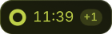 | **Running**: a ring drains, digits never jitter (tabular figures, fixed width). `+1` means another timer is running. |
| 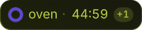 | **Name on demand**: shown for two seconds when a timer starts, and whenever you hover. Hovering never opens anything. |
|  | **Done**: the pill grows red and breathes, the alarm loops, a notification offers *Stop* and *+5 min*. |

The ring turns amber during the last minute and beats during the last ten seconds.

| Gesture on the pill | Action |
| --- | --- |
| Left click | Open the panel (silences the alarm) |
| Right click | Pause / resume, or stop the alarm |
| Scroll | ±1 minute (scroll up on a finished timer = snooze 1 min) |
| Middle click | Cancel |

## The hourglass panel

<table>
<tr>
<td align="center">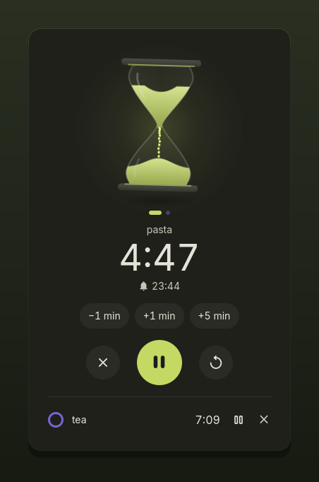 <b>Running</b></td>
<td align="center">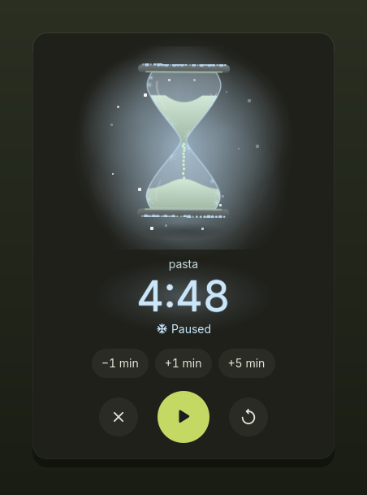 <b>Paused, frozen</b></td>
</tr>
<tr>
<td align="center">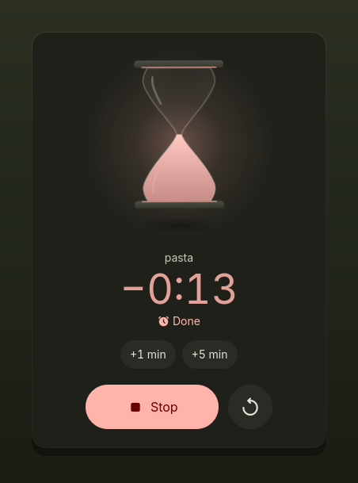 <b>Done</b></td>
<td align="center">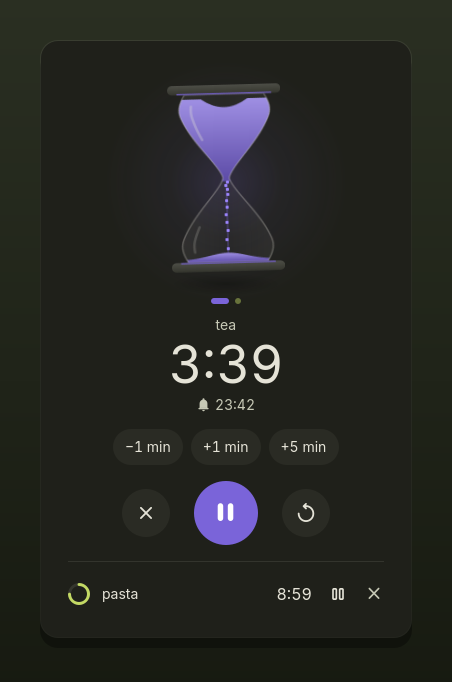 <b>Every timer has its color</b></td>
</tr>
</table>

- **A floating hourglass.** It levitates, tilts and casts a breathing shadow.
- **Sand synced by volume.** The bulbs' profile is integrated, so at half time exactly half the sand is left on top.
- **Freeze on pause.** Time slows to a stop, grains hang mid-air, frost settles on the glass, the digits turn ice-blue. It thaws just as smoothly.
- **Flip to restart.** The restart button turns the hourglass over and starts again.
- **A click is just for fun.** Click the hourglass: it spins twice and hops. Nothing about your timer changes, so you can never restart one by accident (with *Reduce motion*, it stays still).
- **Colors follow your theme.** The first timer uses your accent color; each additional timer gets a harmonious hue derived from it. Alerts use the theme's warning (last minute) and error (done) colors.

| Gesture on the hourglass | Action |
| --- | --- |
| Click | A spin and hop, just for fun (the timer is untouched) |
| Scroll | ±1 minute |
| Swipe / horizontal scroll | Next or previous timer (dots show where you are) |
| <kbd>Space</kbd> / <kbd>Esc</kbd> | Pause–resume / close |
| Restart button (↻) | Turns the hourglass over and starts again |

**Two hourglasses.** The classic one, or **Glass of Time**, a nod to *Steven Universe*: the glass floats in a cyan sphere with a gold ring around its waist. Only the frame changes.

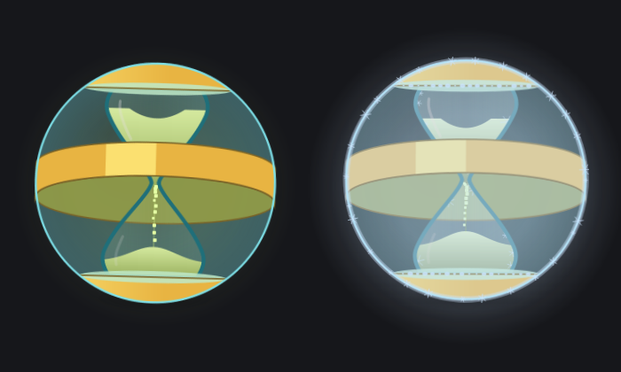

## The time journal

The panel has a second screen, **This week**, that adds up the time of the timers that rang since Monday, name by name. Open it from the link under the hourglass; "Back to timers" returns. Nothing is read or drawn until you open it.

- **Strata** (default): the week as a glass filling with layers. The longest name is the bottom layer, each layer has its own texture so it is readable without colour, and the legend gives the time. After five names the rest folds into "N more names".
- **Threads**: one thin bar per name, longest first, up to seven, the rest folded the same way.
- Times read "48 min", "1 h 15" or "6 h". A very long name is cut with an ellipsis, and the full name shows when you hover it.
- With no timer finished this week, the screen says so and shows nothing else.
- **Clear the journal** erases the private history at once. Nothing is sent anywhere: the history stays in the file described under [Privacy](#privacy).
- With Reduce motion on, the glass and the bars appear already full.

## Pinned favourites

Under the buttons of the panel, "Most started" lists the three timers you start most often, each from its second start on. One click (or Enter, or Space on the focused one) starts it again with the same name and duration, and the tile says "Started" once Sands has really started it (nothing changes if it was refused, for example at the timer limit). The list is read from the time journal each time the panel opens, never while it stays open. Until a timer has been started twice, the panel shows "The three timers you start most often will be pinned here." Timers without a name ("Timer", "Alarm") are never pinned. A long name is cut with an ellipsis and shows in full when you hover it. The list hides while the week screen is open.

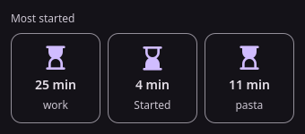

By default each favourite is a tile with a glass (the "Three glasses" look). The "Rows" look is one line per favourite with the number of starts. With Reduce motion the glass does not turn over; only the text changes.

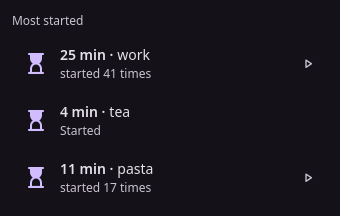

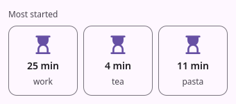

## The launcher

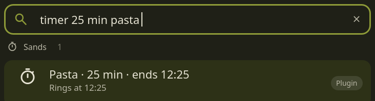

No prefix needed: Sands only answers when what you type looks like a duration, and stays silent otherwise. Type `timer` alone to get your most used timers first (frequent *and* recent), then 5, 10 and 25 min, then the running ones.

**Cancel from the keyboard**: type `timer stop` (or `stop timer`, `cancel timer`). With one timer, <kbd>Enter</kbd> cancels it; with several, you pick which one, or *Cancel all*. Anything else you type with `stop` in it is left alone.

## Syntax

Type in English or French, words or digits, in any order:

| Input | Result |
| --- | --- |
| `20 min`, `20m`, `timer 20` | 20 minutes |
| `1h30`, `1h 30`, `1.5h`, `1,5 h`, `90 min` | 1 hour 30 |
| `1h30m20s`, `5m30`, `90s`, `1:30`, `1:02:03` | Exact durations (`1:30` = 1 min 30 s) |
| `half an hour`, `an hour and a half`, `twenty five minutes` | Spelled-out durations |
| `une demi-heure`, `trois quarts d'heure`, `2 heures et quart` | Same in French |
| `12 min pasta`, `pasta 12 min`, `pasta for 12 min` | A named timer |
| `4x 1h`, `4* 1h`, `1h x4` | Four timers of one hour (up to 20); they count once in your recents |
| `at 18:30`, `at 6pm`, `at noon`, `à 18h` | An alarm at a time of day (tomorrow if already past) |
| `timer 14h30` | Offers both: *alarm at 14:30* first, *14 h 30 timer* second |

**Limits.** A timer lasts between 1 second and 100 hours, `4x` goes up to 20 timers at once (`99x 1h` starts 20 and says so), at most 50 timers run together (`4x 1h` with two places left starts two and says *Started 2 of 4*), a query is read up to 200 characters and a label keeps its first 60. Anything outside these limits, or a query Sands can't read, shows a short message with a link back to this section: nothing is refused silently. `dms ipc call smartTimer add` follows the same 100-hour limit.

The interface is in English. Want Sands to understand another language? [Open an issue](https://github.com/lung595/Sands/issues).

### Natural phrases

Sands also reads sentences, in English or French. These all work with or without the word `timer` in front.

| You type | Sands understands |
| --- | --- |
| `timer 20m pâtes`, `timer 1h30 réunion` | A timer named *Pâtes* (20 min) or *Réunion* (1 h 30) |
| `timer cooked 25m`, `timer folded 45m` | Context words stay in the name: *Cooked* (25 min), *Folded* (45 min) |
| `remind me to call mum 10` | *Call mum*, 10 minutes |
| `pasta 12`, `pâtes 12` | A bare number closing a word is minutes: *Pasta*, 12 min |
| `wake me up at 7`, `réveille-moi à 7h` | An alarm at 07:00 (the next 07:00 within 24 h) |
| `until 6pm`, `jusqu'à 18h` | An alarm at 18:00 |
| `tonight at 9`, `ce soir à 9h` | An alarm at 21:00 |
| `tomorrow at 8`, `demain 8h` | An alarm at 08:00 on the next calendar day |
| `noon`, `midi`, `midnight`, `minuit` | An alarm at 12:00 or 00:00 |
| `7 du soir`, `7 in the morning`, `9 du matin` | An alarm at 19:00, 07:00, 09:00 |
| `8h`, `timer 14h30` | Ambiguous: both readings are listed (see below) |

**Clock times.** A bare hour after `at` / `à` is the next time that hour comes round within 24 hours: at 21:47, `at 7` is tomorrow 07:00. `tomorrow` always means the next calendar day.

**Both readings, never a guess.** `8h` can be an 8-hour timer or 08:00. Sands lists the two, the likelier first, and nothing starts until you press <kbd>Enter</kbd> on the one you pick.

**Typos.** A unit one letter off is still read: `20 mni`, `1 heur`, `20 minuts pasta`, `10 secnds tea`. Names are never corrected: `20 min pasat` keeps *pasat*. Real words near a unit stay words: `3 jours`, `4 cours` and `2 hors` are not hours.

**A bare number.** When you type without the word `timer`, a number counts as minutes only right after a word and up to 180: `pasta 12` is 12 min, `pasta 181` and `12` alone are not timers, and after a preposition (`dans 12`) it is left alone. With `timer` in front the number is yours to give: `timer 12` is 12 min and `timer pasta 181` is 181 min.

**Unknown words.** If you ask for a timer but Sands cannot read it (`timer blorp`), the launcher says *Unknown word « blorp »* instead of staying empty. <kbd>Enter</kbd> opens this guide.

### What the launcher shows

When your text is a timer, the first line says exactly what <kbd>Enter</kbd> will create, and the line below says when it rings:

| Preview | Meaning |
| --- | --- |
| `Pasta · 12 min · ends 12:42` | A named timer |
| `Timer · 12 min · ends 12:42` | No name given |
| `Wake up · at 07:00 tomorrow` | An alarm; *tomorrow* appears when it is not today |
| `Pasta · 4 × 12 min · ends 12:42` | Several timers at once |

Nothing starts before <kbd>Enter</kbd>. Everything is read on your machine; Sands makes no network call.

## Snoozing from a keybind

`dms ipc call smartTimer snooze 10` restarts the ringing timer for 10 minutes. A length outside 1 to 120 minutes is clamped; `0` gives 5 minutes (the length is required: Quickshell has no optional IPC arguments). The answer is always JSON: `{"snoozed":true,"minutes":10}`, or `{"snoozed":false,"reason":"nothing is ringing"}` when no timer rings, in which case nothing changes. `start`, `stop` and `status` cover starting, stopping and reading the time left.

## Reading the timers from a script

`dms ipc call smartTimer status` prints the running and paused timers as JSON: for each one its label, the seconds left and its phase. It is built only when you call it, so nothing runs in between. `list` gives the same information as plain text.

## Settings

The page has a left rail of sections (Timers, Appearance, Alerts & sounds, Advanced, Help) and a search bar on top; one section is shown at a time. Type a few letters of a name, a help line or a synonym (French works, small typos are forgiven): **Enter** opens the first result, jumps to its section and the setting fades in once. **Esc** clears the search, **Ctrl+F** or **/** focuses it. A setting with a real battery cost carries a chip (*High*, *Some* or *Light on battery*) and a one-line note. Nothing is built until the page opens; then every section is built once and only the current one is shown.

| Setting | Description | Default |
| --- | --- | --- |
| Hourglass | Classic or Glass of Time | Classic |
| Sound | One of the two rings that come with Sands, any installed sound theme file, or your own file: see [Sound](#sound) | Hourglass |
| Volume | | 80 % |
| Alarm duration | The sound stops by itself; the pill keeps pulsing | 60 s |
| Notification when done | With *Stop* and *+5 min* | On |
| Gentle alarm | Starts at 30 %, rises to full volume | On |
| Final countdown ticks | A soft tick on each of the last 10 seconds | Off |
| Respect Do Not Disturb | No sound; the pill still pulses | On |
| Automatic detection / Prefix | Answer any duration in the launcher, or only after your prefix | Automatic detection |
| End actions | One row per action: Power off, Sleep, Stop the music and your own commands, each with its launcher words: see [End actions and their words](#end-actions-and-their-words) | One word each, no own command |
| Erase history | Deletes the journal and the favourites at once: see [Erasing the history](#erasing-the-history) | Button |

DMS's *Reduce motion* is respected: no floating, no spin or flip animation.

### End actions and their words

In **Timers**, each end action has a row: Power off, Sleep, Stop the music, then your own commands. Type one of its words after a timer to start it when the timer ends, for example `45m film off`. Any word works, even a made-up one.

> **Not yet:** the rows save your commands and words, but nothing runs them when a timer ends until the end action runner lands (a separate story). Until then a word after a duration does nothing.

- **Add a word**: type it in the small field and press Enter. It is lower-cased and spaces are removed. A row holds at most 8 words of 24 characters; click a chip to remove its word. **Reset the words** puts every action back to its default word.
- A word is refused, with the reason beside the field, when it is empty, too long, has characters other than letters, digits, `-` and `_`, starts with a digit, reads as a number or a unit of time (`30`, `min`), or already belongs to another action. Nothing is saved in that case.
- **Add a command** asks for a name (up to 40 characters) and the command: a program name or an absolute path, then its arguments separated by spaces (at most 16 of 200 characters). There is no quoting and no shell: the text is split on spaces and run as a program with its arguments. A program starting with `-`, or with a control character, is refused. You can keep 16 commands. Edit the name or the command in place and press Enter to save; **Remove** deletes the command and its words.
- A command runs without any question asked. Power off and Sleep always ask first.

### Erasing the history

In **Advanced**, **Erase history** deletes the file that holds the journal and the favourites, at once and without a question: both then show their empty state. The file is Sands' own, on this machine only; nothing is sent anywhere.

### Sound

The list starts with the two rings that come with Sands, then the sounds installed on the machine, then *Custom file…*. *Preview* plays the choice shown, at the volume you set.

- **Hourglass** (default): four soft rising glass notes, one grain after the other. Made for Sands.
- **Silt Chime**: a short, soft bell struck twice.
- **A system sound**: any `.oga`, `.ogg`, `.wav`, `.mp3` or `.flac` of the installed sound themes or of `~/.local/share/sounds`. The former default, *Alarm clock elapsed*, is now one of them.
- **Custom file…**: type a full path, or one starting with `~/`, in *Sound file*.

Both rings start within 150 ms and begin and end on silence, so they work with *Gentle alarm* (which starts at 30 %) and loop without a click. An unset *Sound* plays Hourglass; a sound you chose yourself keeps playing as saved.

### Visual alert

*Alerts & sounds* has three cards: **Rising dune** (sand rises from the bottom edge, default), **Edge halo** (a rim of light around every screen) and **None**. With Rising dune, *Rising dune style* shows one card per style: **Last grains** is the one drawn today; **Wind dune** and **Flat wave** are greyed and marked "Not available yet" until their scenes are written. *Show above full screen* (off by default) lets the dune rise over a full-screen window; it applies to the dune only. *Show the visual alert* chooses between "Every time" (default) and "When sound is off". **Test the alarm** plays the sound and shows the chosen alert once, with the fake name "Pasta"; it stops by itself after a few seconds, or at once with a click on its legend. The choices apply to the next ring, without restarting the shell.

- **Edge halo is greyed**: it is drawn through the Wayland layer shell, which this session does not offer (for example X11). Pick Rising dune, or log in to a Wayland session.

### If the alarm makes no sound

When the alarm cannot play its sound, Sands says so instead of staying quiet: **The alarm made no sound** (in the panel if it is open, otherwise as a DMS notification). **Preview** in the settings does the same with **Could not play this sound**. The pill still pulses either way.

- **A file of your own**: check the path in *Sound file* (a full path, or one starting with `~/`) and that the file is an `.oga`, `.ogg`, `.wav`, `.mp3` or `.flac` you can open.
- **A sound theme file**: pick another one in *Sound*. Hourglass and Silt Chime are files of Sands itself, so they need nothing else; the system sounds come from your sound theme packages, such as `sound-theme-freedesktop`.
- **No player**: Sands plays with `pw-play` (PipeWire) and falls back to `paplay`. Run `pw-play /usr/share/sounds/freedesktop/stereo/complete.oga` in a terminal: an error there is the same one Sands met.
- **Nothing is wrong but it is silent**: *Volume* is at 0, the output device is muted, or *Respect Do Not Disturb* is on while Do Not Disturb is active (no message then: that silence is on purpose).

## Alex

If the Alex plugin is loaded, Sands publishes one event when a timer ends: a fixed `kind` field (`timerFinished`), an id, the timer label (60 characters at most) and the end time. The event lives in the shell's memory only (nothing is written to disk, no process starts), and any loaded plugin can read the last one. Without Alex Sands makes no call at all. Sands always shows its own alarm, plays its sound and keeps its bar pill. If several timers end in the same tick, one event is published for each, in order; Alex that loads late sees only the last one.

### When a Sands timer ends

The last row of *Alerts & sounds* picks who shows the alarm: **Sands only**, **Sands + Alex reacts** (the default) or **Alarm in the Alex island**. Sands always keeps its sound and its bar chip, whatever you pick. The small bar under the row shows what rings where.

The value belongs to Alex: the same choice is in Alex's settings, and a change in either page shows in the other while both are open. Sands keeps no copy and writes nothing in Alex's settings. It asks Alex through `dms ipc call` and follows the notice Alex publishes, only while this page is open.

If Alex is not installed or is turned off, the row is greyed with nothing selected and Sands rings on its own. Install or enable Alex, then reopen the page. Nothing listens and nothing polls while the row is greyed or the page is closed.

## Privacy

- **No network access, no telemetry.** The guide links in messages open in your browser only when you click them.
- **Short-lived local tools only**: `pw-play` (or `paplay`) to ring, `notify-send` / `gdbus` for the notification, and a one-off `find` over the system sound folders while the settings page is open.
- **Written to disk**, through DMS's plugin state: your running timers (end times and labels) and your recent timers.
- **Private history**: when a timer rings, its name and times are kept in `~/.local/state/sands/history.json`, readable by you only (mode 0600 in a 0700 folder), 12 months at most. It is written at the ring only, never while a timer runs or at rest, and uninstalling Sands removes the file and its folder. Nothing else is written.
- **Settings** are stored by DMS with your other plugin settings.

## Performance

Sands costs nothing while you are not looking at it. In % of one CPU core for the whole shell, 240 Hz display (DMS alone: about 2 %):

| Situation | 1.3.0 |
| --- | --- |
| Timer running, panel closed | Same as DMS alone (2.1 %) |
| Panel open, sand flowing | 6.5 % |
| Panel open, paused (frozen) | 3.9 % |

How this is achieved is in [CONTRIBUTING.md](../CONTRIBUTING.md#performance-rules).
